# Guitar Studio user manual

Guitar Studio is a guitar rig on your computer. It loads your amp sims and effect plugins
(VST3, Audio Unit and CLAP), wires them together freely, and gives you a pedalboard you
play with the mouse, the keyboard or your phone. It has a tuner and metronome built in,
and it runs both as an app and as a plugin inside your DAW.

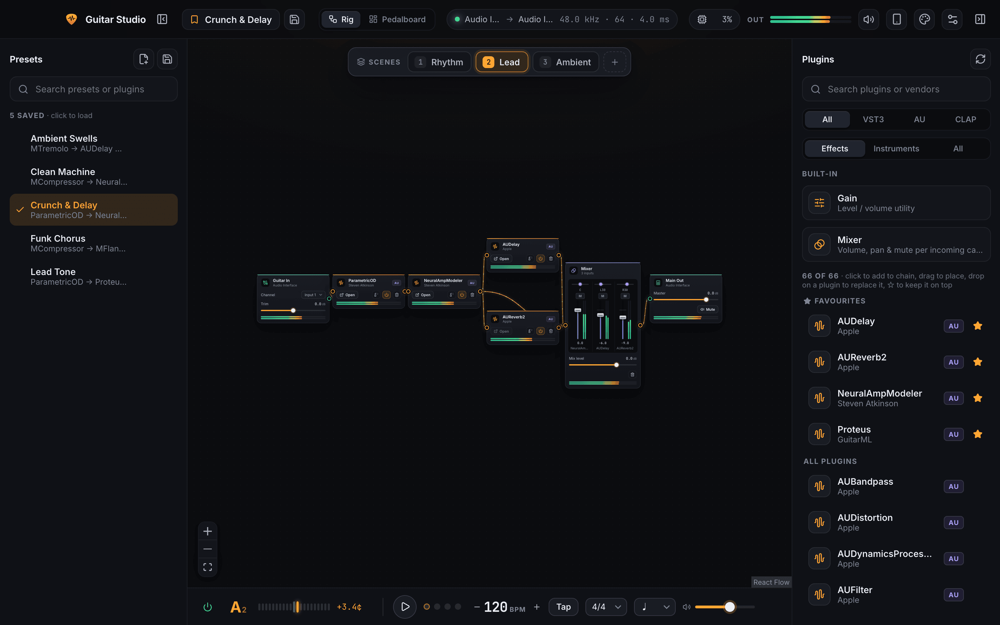

**Contents**

1. [Getting started](#1-getting-started)
2. [The main window](#2-the-main-window)
3. [Building a rig](#3-building-a-rig)
4. [Presets](#4-presets)
5. [Scenes](#5-scenes)
6. [The pedalboard](#6-the-pedalboard)
7. [On stage](#7-on-stage)
8. [Tuner and metronome](#8-tuner-and-metronome)
9. [Phone remote](#9-phone-remote)
10. [Themes](#10-themes)
11. [Inside a DAW](#11-inside-a-daw)
12. [Keyboard shortcuts](#12-keyboard-shortcuts)
13. [Files and troubleshooting](#13-files-and-troubleshooting)

On Windows, use Ctrl where this manual says ⌘. The app's own hints already show Ctrl there.

---

## 1. Getting started

**Install.** Download the installer from the
[Releases](https://github.com/bojanpetrovic/guitar-studio/releases) page: the `.pkg`
for macOS 13 or newer, or the setup `.exe` for 64-bit Windows 10 / 11. Each installs
the app and the VST3 and CLAP plugins. The installers aren't code-signed yet, so your
computer asks once before running them:

- **macOS:** open the `.pkg`, click **Done** at the warning, then go to
  **System Settings → Privacy & Security** and click **Open Anyway**.
- **Windows:** when SmartScreen says *Windows protected your PC*, click
  **More info → Run anyway**.

**Choose your audio interface.** Open **Audio settings** (the sliders button at the
right of the title bar). Pick your interface for input and output, and a buffer size.
Smaller buffers feel tighter but cost more CPU; 64 or 128 is the sweet spot for playing
live. On Windows, choose your interface's **ASIO** driver (listed as "ASIO: …") for the
lowest latency. An ASIO driver handles input and output together, and its buffer size
and sample rate may only change in the driver's own control panel.

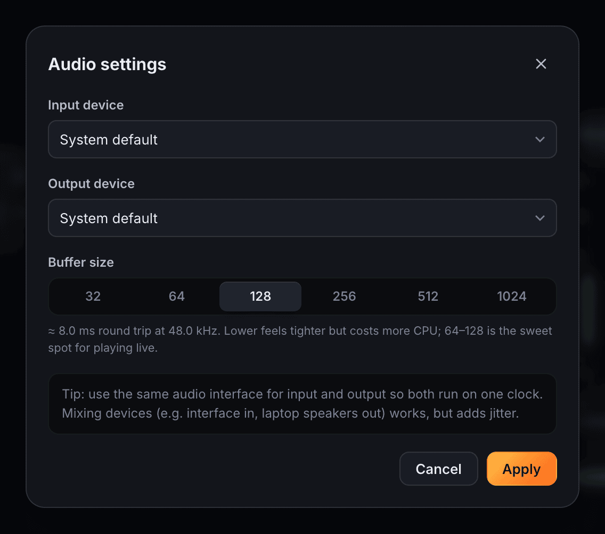

**Find your plugins.** The first time, the plugin list is empty. Click the refresh
button at the top of the **Plugins** panel to scan. A full scan takes about a minute and
is remembered. Each format is scanned in a separate process, so a plugin that crashes
while being scanned can't take Guitar Studio down. Scan again after you install new
plugins.

---

## 2. The main window

From left to right, the **title bar** holds:

- the button that shows or hides the **Presets** panel (⌘P);
- the current **preset's name** (click it for the presets) and **Save** (⌘S);
- **Rig** / **Pedalboard**, the two views (⌘1 / ⌘2);
- the **audio status**: input → output device, sample rate, buffer size and the
  round-trip latency;
- the **CPU** load of the audio, the **OUT** meter and the **mute** button;
- the **phone remote**, **theme** and **Audio settings** buttons, and the button that
  shows or hides the **Plugins** panel (⌘B).

Below it are the **Presets** panel, the **canvas** with your rig, the **Plugins**
panel, and at the bottom the **dock** with the tuner and the metronome.

---

## 3. Building a rig

A rig is a set of boxes ("nodes") joined by cables. The signal comes in at
**Guitar In**, flows along the cables, and leaves at **Main Out**.

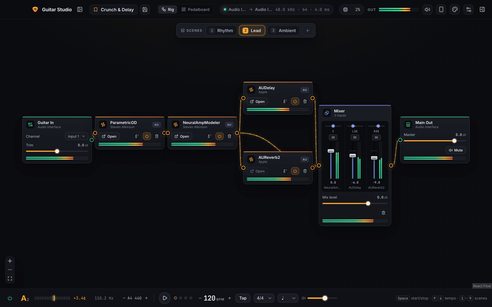

**Adding plugins.** In the **Plugins** panel, click a plugin to add it at the end of the
chain, or drag it onto the canvas to place it yourself. Drop a plugin onto an existing
node to replace that one. Search by name or vendor, and filter by format (VST3, AU,
CLAP) or kind (effects, instruments). Hover a plugin and click ☆ to keep it in
**Favourites** at the top of the list.

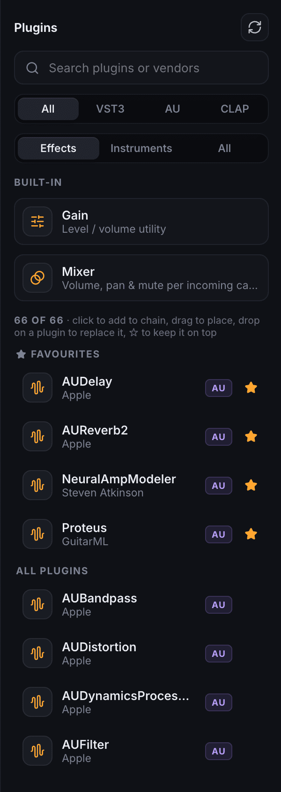

**Cables.** Drag from a node's output (the dot on its right) to another node's input
(the dot on its left). A node can feed several others, and several cables into one input
are summed, which is how you build parallel paths. To remove a cable, click it and
then its ×, or press ⌫. Loops aren't allowed.

**Nodes:**

- **Guitar In:** which input of your interface the guitar is on (**Channel**), and a
  **Trim** for its level.
- **Plugins:** **Open** shows the plugin's own window. ⇄ replaces it with another plugin.
  The power button turns it off (bypass), and the bin removes it. The meter shows its
  output.
- **Gain** (built in): a simple level control.
- **Mixer** (built in): every cable coming in gets its own channel strip with volume,
  pan, mute and a meter, and **Mix level** sets the total. Use it to blend parallel
  paths, such as two amps, or a dry amp with a wet delay. Pan is balance-style: a
  centred strip passes stereo at full level, and turning one way fades the other side.
- **Main Out:** the **Master** level and **Mute**.

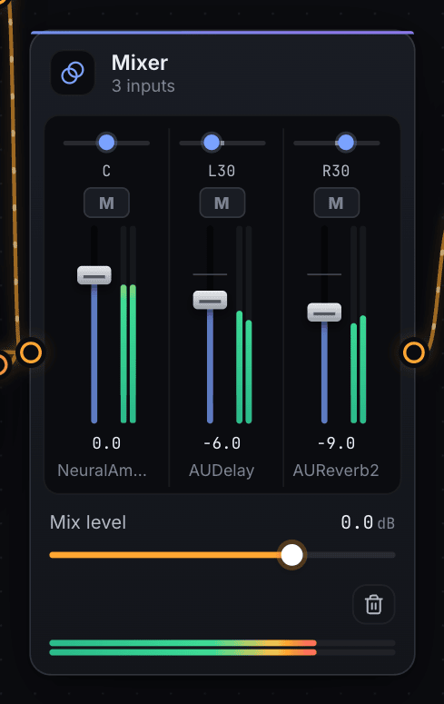

Drag nodes to arrange them. The buttons at the bottom left zoom, and the last one fits the
whole rig on screen.

**Replacing a plugin** keeps its cables, place and on/off state, so pedalboard switches
keep working. Click ⇄ on the node, or drop a plugin from the list onto it. Plugins from
the same vendor come first, and your favourites before the rest. The new plugin starts
at its own defaults. Pedalboard controls move to its parameters with the same names, and
you're told about any that need rebinding.

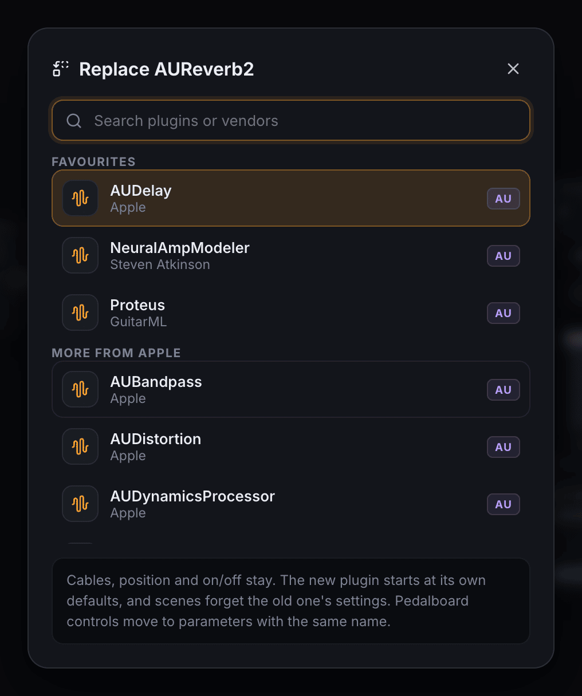

---

## 4. Presets

A preset keeps the whole rig: plugins, cables, levels, on/off states, the input channel,
the tempo, scenes, the pedalboard, and every plugin's own settings, exactly as you left
them in the plugin's window.

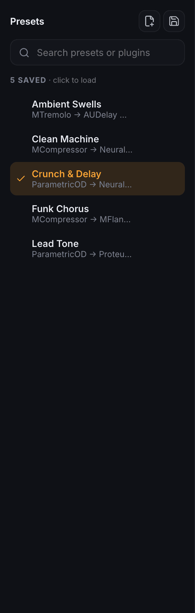

- **⌘S** saves the current preset (the first time, it asks for a name). **⇧⌘S** saves a
  copy under a new name.
- The **Presets** panel lists them all. Click one to load it, and search by preset or
  plugin name. Hover a preset to rename or delete it. The buttons at the top make a new,
  empty rig or save the current one as a new preset.
- The app opens the preset you last used.
- If a preset uses a plugin that isn't installed, the rest still loads and you're told
  which one is missing.
- **Switching is quick.** Plugins the next preset shares with the current one keep
  running and just get their new settings. The presets before and after the current one
  in the list are prepared in the background (*Preloading …* in the title bar). A
  delay's or reverb's tail rings on into the next preset.

---

## 5. Scenes

Scenes are variations of one rig, such as a rhythm, a lead and an ambient sound. A scene
remembers every plugin's settings and on/off state, the Gain and Mixer levels, and each
mixer strip.

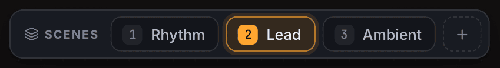

- Press **1–9** or click a scene to switch. The audio keeps running, and only the
  settings that differ change.
- **+** adds a scene from the current sound (up to nine). Then shape the new one.
- Whatever you change goes into the active scene.
- Double-click a scene to rename or delete it.
- The scene bar is at the top of the rig and under the pedalboard. To hide it under the
  board, untick *Show scenes under the board* in the board's settings (edit mode, nothing
  selected).

---

## 6. The pedalboard

Each preset can have a pedalboard: a control surface you lay out yourself and wire to the
rig. Switch to it with **⌘2**.

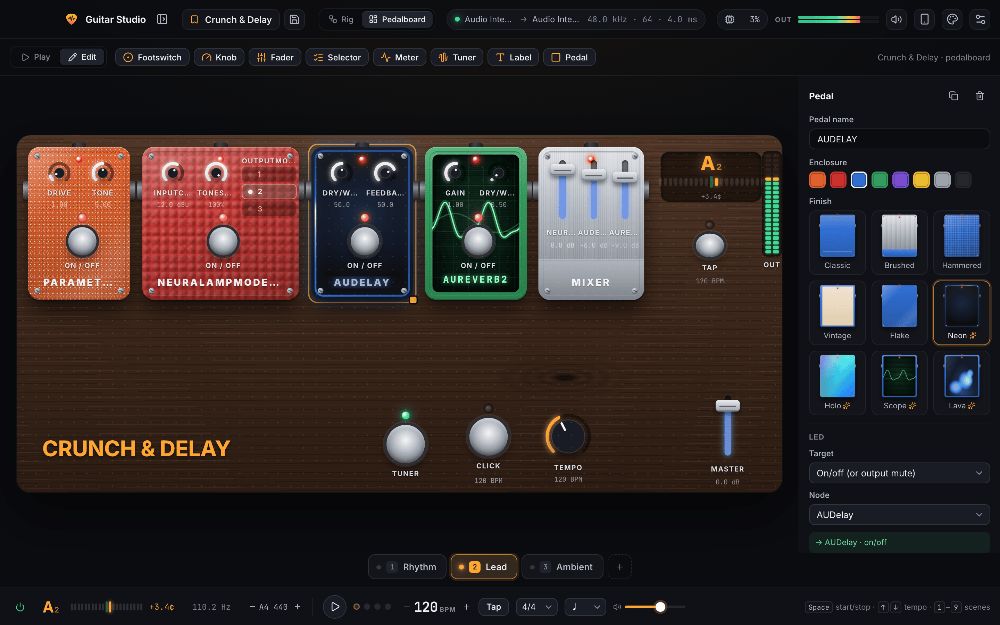

**Build from rig** makes a first version for you. You get a pedal per plugin with its
on/off footswitch, its two main knobs and, where it has one, an amp or channel selector,
plus a fader pedal per mixer, tap tempo, a tuner and an output meter. Change it from
there, or start from scratch.

**Play and Edit.** In **Play** mode the controls work: stomp the switches, turn the
knobs, move the faders. They also follow changes you make inside a plugin's own window.
**Edit** (⌘E) is for designing the board:

- Add **footswitches, knobs, faders, selectors, meters, labels, pedals** and **tuner**
  displays from the toolbar.
- Drag to move and pull a corner to resize; everything snaps to a grid. ⌫ deletes, ⌘D
  duplicates, and the arrow keys nudge.
- Select several controls with ⇧-click (or ⌘-click), by dragging a box over an empty part
  of the board, or with ⌘A, then move, nudge, duplicate or delete them together.
- **⌘C / ⌘X / ⌘V** copy, cut and paste, onto another preset's board too.

**Wiring a control.** Select it and choose what it drives in the inspector on the right:
a plugin parameter (searchable), a node's on/off or level, a mixer strip's volume, pan or
mute, the metronome, tap tempo, the tempo, or the tuner. Meters show any node's output
or the main out.

**Pedals** are stompbox enclosures to group controls on. Pick their colour and finish:
Classic, Brushed, Hammered, Vintage, Flake, or the animated Neon, Holo, Scope and Lava.
Wire a pedal to a plugin's on/off (Build from rig does this) and its LED shows whether
the plugin is on. Animated finishes only move while it is.

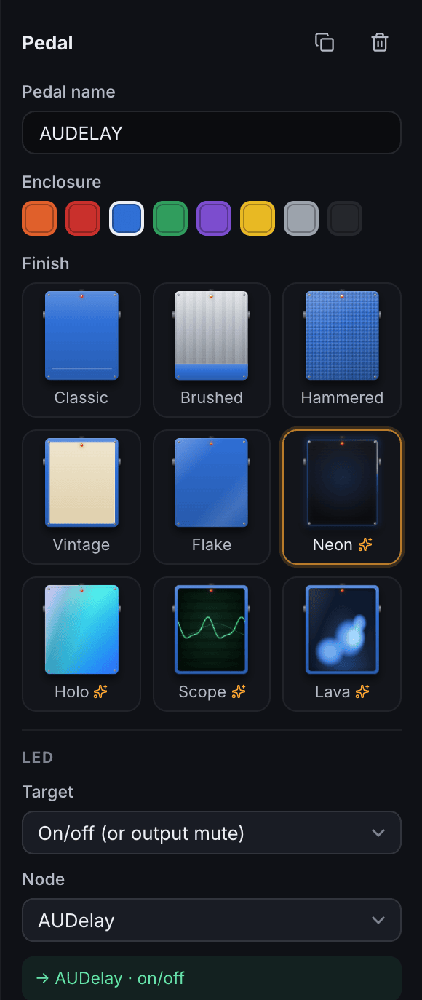

**The board's surface.** With nothing selected, the inspector shows the board's
background: Slate, Carbon, Steel, Tolex, Tweed, Velvet, Blueprint, a range of woods, and
animated ones (marked ✦) such as Aurora, Synthwave, Cosmos, Plexus, Bokeh and rising
sparks in five colours. Animated surfaces hold still when your system's *Reduce motion*
setting is on.

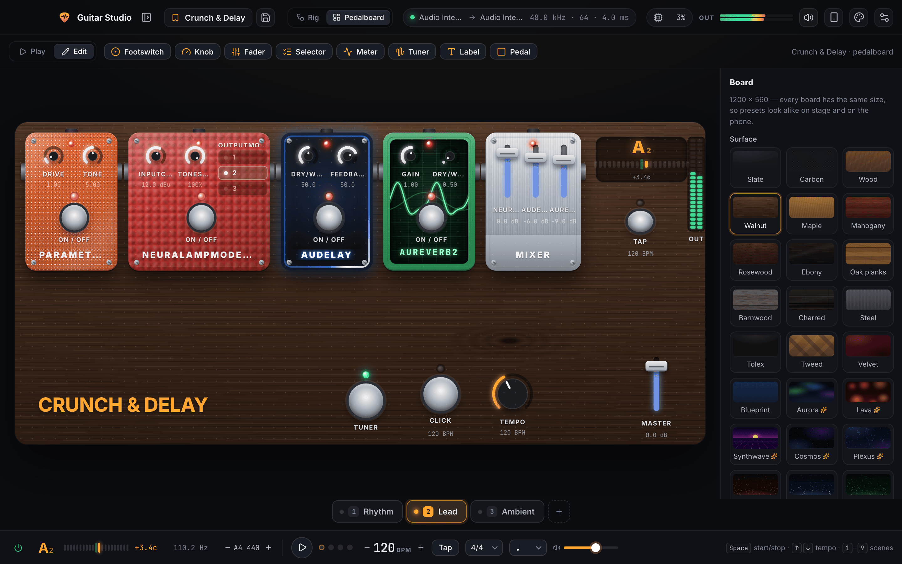

**Keyboard keys.** Give a footswitch, knob, fader or selector a key (*Keyboard key* in
the inspector) to play it from the computer keyboard:
- A switch's key stomps it. A momentary switch stays pressed while the key is down.
- A knob's, fader's or selector's key selects it, and it glows: then ↑ / ↓ turn it (⇧ for
  bigger steps). Press the key again, another control's key, or Esc to let go.
- Keys the app already uses (Space, the arrows, 1–9, Esc…) can't be assigned. One key on
  several controls moves them all.

---

## 7. On stage

Playing the pedalboard puts it **on stage**. The window shows only the board, with the
tuner and metronome underneath. It loses its frame and takes the board's shape, so you
can keep it small next to other windows; drag the board to move it.

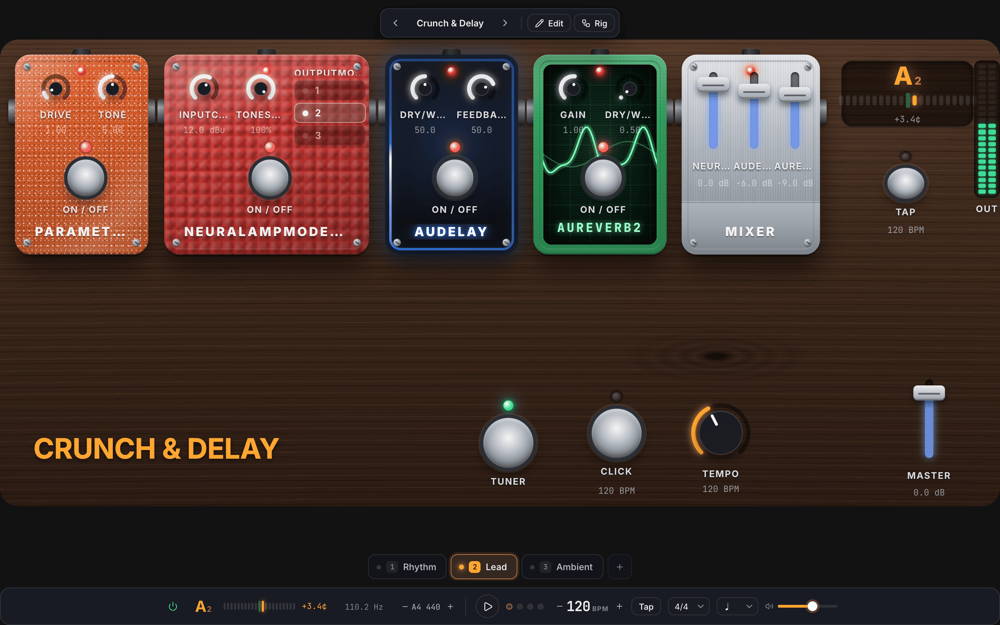

Move the mouse to show a small bar with the preset's name: **← / →** (or Page Up / Page
Down, or [ / ]) switch presets, **Edit** edits the board, **Rig** goes back to the rig.
⌘E, Esc or ⌘1 also leave the stage, and the window returns to its old size and place.

---

## 8. Tuner and metronome

The dock at the bottom of the window is always there, on stage too.

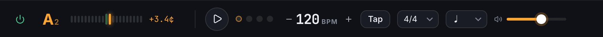

**Tuner** (left): the note, how many cents off it is (the strip is centred when in
tune) and the frequency. Set the reference pitch (A4 = 440 Hz by default) with − / +. The
power button turns the tuner off. It listens to the input your Guitar In node uses.

**Metronome** (right): play / stop (Space), the beats of the bar, the tempo (− / +, or
↑ / ↓; hold ⇧ for steps of 5), **Tap** tempo, beats per bar, subdivision, and the click's
volume. The tempo is saved with the preset, and plugins that sync to tempo (delays, for
instance) follow it.

---

## 9. Phone remote

Play the pedalboard from your phone, with nothing to install on it.

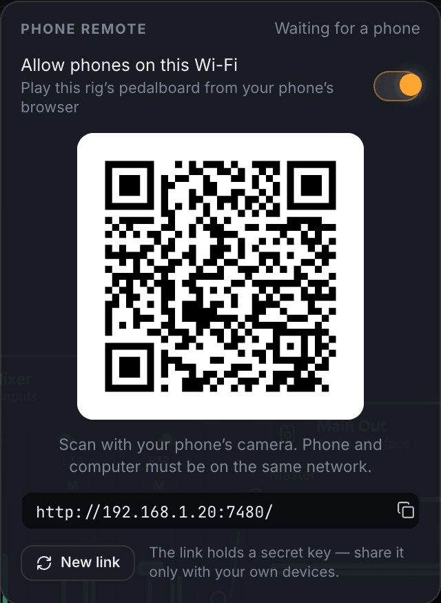
&nbsp;&nbsp;
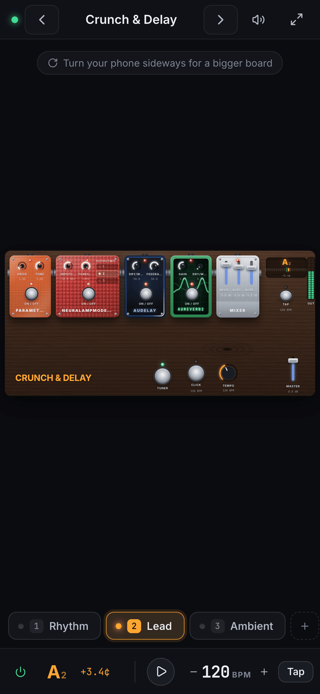

1. Click the phone button in the title bar and turn on **Allow phones on this Wi-Fi**.
2. Scan the QR code with your phone's camera. The pedalboard opens in its browser.

- The phone controls the whole rig: switches, knobs, faders, scenes, presets (‹ ›), the
  tuner and the metronome. Turn the phone sideways for a bigger board.
- Changes on either side show up on the other.
- The phone plays but doesn't edit: design the rig and the board on the computer.
- The phone and computer must be on the same network. The first time, your computer may
  ask whether Guitar Studio may accept incoming connections; allow it.
- The link holds a secret key, so share it only with your own devices. **New link** makes
  a new one and disconnects phones using the old one.
- On an iPhone, Share → *Add to Home Screen* opens it full screen; on Android, use the
  full-screen button.

---

## 10. Themes

Click the palette button in the title bar, or press **⇧⌘T** to step through them. There
are four dark themes (**Amber**, **Midnight**, **Neon**, **Graphite**) and two light ones
(**Daylight**, **Paper**). *Match system appearance* follows your computer's light or
dark mode. The pedalboard's hardware keeps its look in every theme.

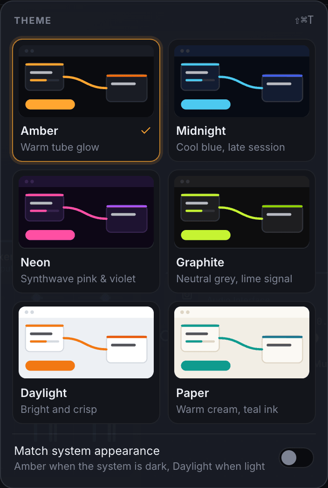

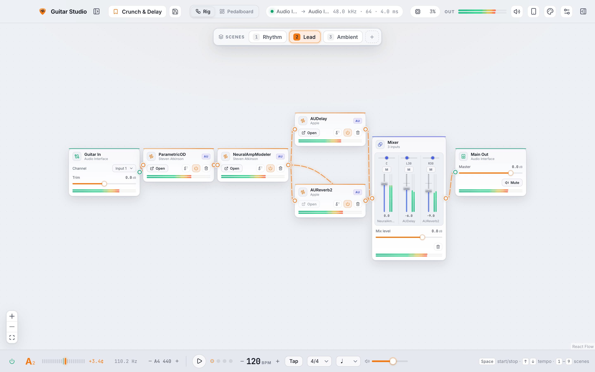

---

## 11. Inside a DAW

Guitar Studio is also a VST3 and CLAP effect plugin, so a whole rig (its plugins, cables,
pedalboard and scenes) can sit on a track in REAPER, Ableton Live, Cubase, Bitwig, Studio
One and others. The installer puts the plugins where DAWs look for them.

1. Rescan plugins in your DAW. In REAPER: Preferences → Plug-ins → VST → *Re-scan*. CLAP
   plugins are picked up on their own.
2. Put **Guitar Studio** on a track with your guitar as its input.

The plugin's window is the same app: rig, pedalboard, presets and scenes all work.

- **The audio comes from the track.** The DAW sets the sample rate and buffer, so there
  are no device settings. A preset made in the app for, say, input 4 of your interface
  just uses the track's input.
- **The rig is saved with the project**, including its plugins' settings. Presets and the
  plugin list are shared with the app.
- **Output** (rig level, −60 to +12 dB) is the parameter the DAW can automate.
- In REAPER, turn on *Send all keyboard input to plugin* (FX window menu) to use the
  pedalboard's keyboard shortcuts.
- Not yet: an Audio Unit version (for Logic and GarageBand), the phone remote inside a
  DAW, and reporting the hosted plugins' latency to the DAW.

---

## 12. Keyboard shortcuts

| Keys | |
|---|---|
| ⌘1 / ⌘2 | Rig / Pedalboard |
| ⌘P / ⌘B | Show or hide the Presets / Plugins panel |
| ⌘S / ⇧⌘S | Save the preset / save as a new one |
| 1 – 9 | Switch scene |
| Space | Start / stop the metronome |
| ↑ / ↓ | Tempo ±1 BPM (⇧: ±5); with a pedalboard control selected, turn it |
| ← / →, Page Up / Down, [ / ] | Previous / next preset (on stage) |
| ⌘E | Play / edit the pedalboard |
| Esc | Leave the stage, or let go of a selected control |
| ⇧⌘T | Next theme |
| **Editing the pedalboard** | |
| ⌫ | Delete |
| ⌘D | Duplicate |
| ⌘C / ⌘X / ⌘V | Copy / cut / paste |
| ⌘A | Select all |
| Arrows | Nudge |
| **On the rig** | |
| ⌫ | Delete the selected node or cable |

Keys are ignored while you type in a field.

---

## 13. Files and troubleshooting

**Where things are:**

| | macOS | Windows |
|---|---|---|
| Presets, plugin list, settings | `~/Library/Application Support/dev.guitarstudio.app` | `%APPDATA%\dev.guitarstudio.app` |
| Plugin log | `~/Library/Logs/Guitar Studio/plugin.log` | `%LOCALAPPDATA%\dev.guitarstudio.app\logs` |
| VST3 / CLAP plugin | `/Library/Audio/Plug-Ins/VST3`, `…/CLAP` | `C:\Program Files\Common Files\VST3`, `…\CLAP\Guitar Studio` |

Presets are plain files in the `presets` folder, so you can back them up or copy them to
another computer.

**No sound.** Check Audio settings, and that Guitar In's **Channel** is the input your
guitar is plugged into: its meter should move when you play. Check that Main Out isn't
muted (the speaker button by the OUT meter) and that the cables reach Main Out.

**A plugin is missing.** Rescan in the Plugins panel. If it still isn't listed, open
*scan issues* in the panel to see what went wrong.

**Crackles.** Raise the buffer size in Audio settings, or turn off heavy plugins you
aren't using. The CPU figure in the title bar shows how busy the audio is.

**Something else.** Please open an issue on
[GitHub](https://github.com/bojanpetrovic/guitar-studio/issues) and describe what
happened. On Windows, an ASIO driver that's busy in another app can't be opened at the
same time.

---

The screenshots come from the real app with free and built-in plugins
(`make docs-screenshots`). ASIO is a trademark and software of Steinberg Media
Technologies GmbH.
